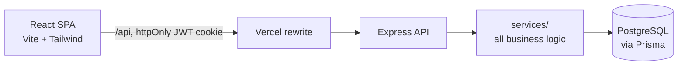

# Shiv Furniture ERP — Mini ERP from demand to delivery

A full-stack mini ERP for a furniture manufacturer. It covers products, sales, purchasing, bills of materials, manufacturing with work orders, a stock ledger, make-to-order auto-procurement, a two-step stock-operation workflow, role-based access and a complete audit trail.

Built with **React + TypeScript**, **Node.js / Express**, **PostgreSQL / Prisma**, with 100 automated API tests.

> **Live demo:** _link added after deployment_ — click **Reset demo data** on the login page first (everyone shares the demo). The free API sleeps when idle, so the first request can take ~30 s.

---

## Try it in two minutes

Log in with one click from the login page — no passwords needed.

| Demo account                       | Role                      | What they can do                                      |
| ---------------------------------- | ------------------------- | ----------------------------------------------------- |
| **System Admin**                   | Administrator             | Everything, plus user management and audit logs       |
| **Sales Manager** (Amit Sharma)    | Sales admin               | Create/confirm sales orders, deliver                  |
| **Purchase Manager** (Neha Verma)  | Purchase admin            | Confirm purchase orders, receive goods                |
| **Production Head** (Meera Singh)  | Manufacturing + BoM admin | Bills of materials, manufacturing orders, work orders |
| **Inventory Manager** (Ravi Patel) | Products admin            | Adjusts stock and confirms any stock operation        |
| **Business Owner** (Shiv Kumar)    | Read-only                 | Sees every module, changes nothing                    |

**The demo script** (the Wooden Table has only 2 in stock):

1. **Sales Manager** → Sale Orders → New → Suzuki India, _10 × Wooden Table_ → **Confirm**.
   The system sees the shortfall and **auto-creates a draft manufacturing order for 8**.
2. **Production Head** → open that MO → **Confirm**. Its components are reserved, and the missing ones
   (12 Wooden Legs, 5 Wooden Tops) **auto-create one purchase order** to Timber Traders.
3. **Purchase Manager** → open the PO → **Confirm** → **Receive**. The receipt is only _placed_.
4. **Inventory Manager** → Stock Operations → **Confirm** the receipt. Now stock arrives.
5. **Production Head** → MO → Work orders → **Mark done** ×3 (Assembly → Painting → Packing) → **Produce** → Confirm.
6. **Sales Manager** → the sales order → **Deliver** 10 → Confirm → _Fully delivered_. Wooden Table stock is back to 0.
7. **System Admin** → Audit Logs, or the **Logs** button on any record: every status change, quantity and price change is there, with old and new values.

---

## Features

- **Products** with sales and cost price, and live **on hand / reserved / free-to-use** (free = on hand − reserved, computed, never stored), plus a per-product stock ledger.
- **Sales orders**: Draft → Confirmed → Partially / Fully Delivered (or Cancelled). Lines warn when free-to-use stock is short. Confirmed orders can still be **edited** (never below what is delivered or pending).
- **Purchase orders**: Draft → Confirmed → Partially / Fully Received.
- **Bills of materials**: components plus operations at work centers.
- **Manufacturing orders**: copy a snapshot of the BoM, scale it to quantity, reserve components, track **work orders** (expected vs real minutes), and **Produce** (consume components, add finished goods).
- **Make-to-order procurement**: products marked _Procure on demand_ auto-create a draft PO (grouped per vendor) or MO for exactly the shortfall when a sale (or an MO's components) can't be covered. Shortage = demanded − max(free-to-use, 0), so nothing is ordered twice.
- **Place → confirm stock operations**: deliveries, receipts, production and stock adjustments are _placed_ by anyone with access, and stock only moves when a **supervisor or manager confirms** them. Operations can also be rejected with a reason, and cancelling an order rejects its pending operations.
- **Role-based access**: per user and per module, _Admin / User / None_ (plus read-only), enforced on the server and mirrored in the UI.
- **Audit log** of every create, field change, status change and delete, written in the same database transaction as the change itself.
- **Dashboard**: status chips for _All_ and _My_ orders per module, late orders, operations awaiting confirmation, and material shortages. Every chip deep-links into a filtered list.
- List and **kanban** views, search, filters and pagination everywhere.

## Architecture



```
client/src   pages/<module>, components/, api/ (fetch client + DTO types), context/ (auth + permissions)
server/src   routes/ (parse + call one service), services/ (business rules), middleware/, config/permissions.ts
server/prisma schema.prisma, migrations, seed.ts
server/test  Vitest + Supertest against a real PostgreSQL test database
```

## Design decisions

- **The stock ledger is the source of truth.** Stock changes only through `StockMove` rows written by one function (`postMoves`). `Product.onHand` is a cache updated in the same transaction, and the tests assert that the ledger sum always equals on-hand.
- **Concurrency-safe stock.** Every stock-changing transaction row-locks the affected products (`SELECT … FOR UPDATE`, in id order to avoid deadlocks). A test confirms two deliveries of the last 5 units at the same moment: exactly one succeeds, and on-hand never goes negative.
- **Consistent lock order.** Source order → stock operation → products, everywhere, so a _cancel_ racing a _confirm_ can't deadlock.
- **Audit in the same transaction** as the change it describes, so the log can't disagree with the data.
- **Two-step stock operations** model how the business actually works (dispatch vs receiving sign-off) and keep reservations intact while an operation waits.
- **Exact decimals.** Quantities are `Decimal(12,3)` and money is `Decimal(12,2)`, and comparisons use decimal math, so delivering 1.25 + 1.25 of 2.5 is exactly _fully delivered_.
- **Permissions in one place** (`config/permissions.ts`), checked inside services, so the same rules apply to the API, seeding and auto-procurement.

## Run it locally

Requirements: Node 20–22 and PostgreSQL 16+ with two empty databases, `minierp_dev` and `minierp_test`.

```bash
cd server
cp .env.example .env          # set DATABASE_URL (minierp_dev) and JWT_SECRET
cp .env.example .env.test     # set DATABASE_URL to minierp_test
npm install
npx prisma migrate dev
npx prisma db seed            # loads the Shiv Furniture demo data
npm run dev                   # API on http://localhost:5000
```

```bash
cd client
npm install
npm run dev                   # http://localhost:5173 (proxies /api to :5000)
```

## Tests

```bash
cd server && npm test
```

100 API-level tests run against a real PostgreSQL database. They cover the stock ledger, reservations, row-lock concurrency, MTO procurement (including the MO → PO chain), every status transition, edit-after-confirm rules, place/confirm/reject operations, permissions, audit and the full demo script end to end.

On Windows with Node 24 the Vitest worker process occasionally aborts natively while Prisma is active (plain Node never does). `npm test` therefore re-runs **only** when the worker crashed and no test failed, and prints a note when it does. Real failures are never retried.

## Deployment

- **API:** Render (`render.yaml`, Node 22), running `prisma migrate deploy` on start.
- **Database:** Neon PostgreSQL.
- **Web:** Vercel (`vercel.json`). `/api/*` is rewritten to the Render API, so the auth cookie stays first-party (`SameSite=Lax`, `Secure`).
- After the first deploy, load the demo data by clicking **Reset demo data**.

## Out of scope

Accounting, invoicing, payments and taxes · multiple warehouses, lots and serial numbers · email and notifications · mobile app · multi-company and multi-currency.
