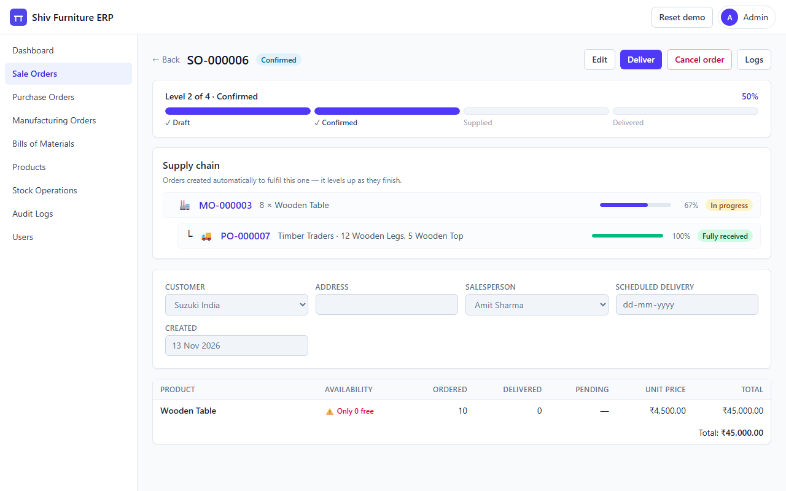
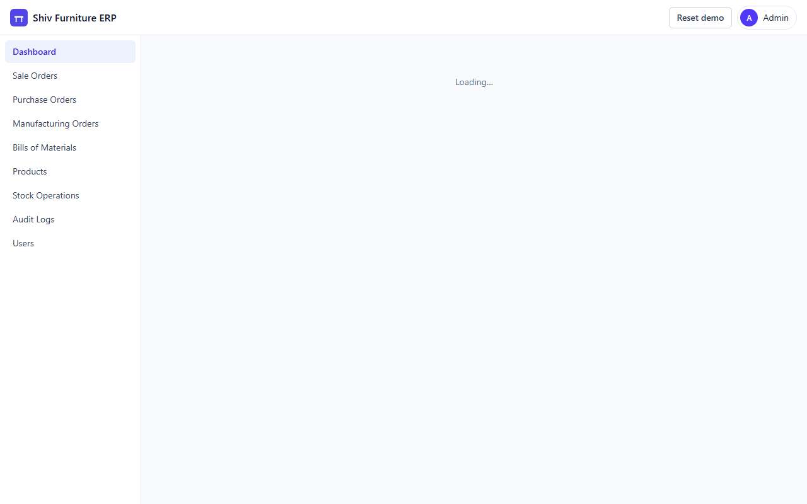
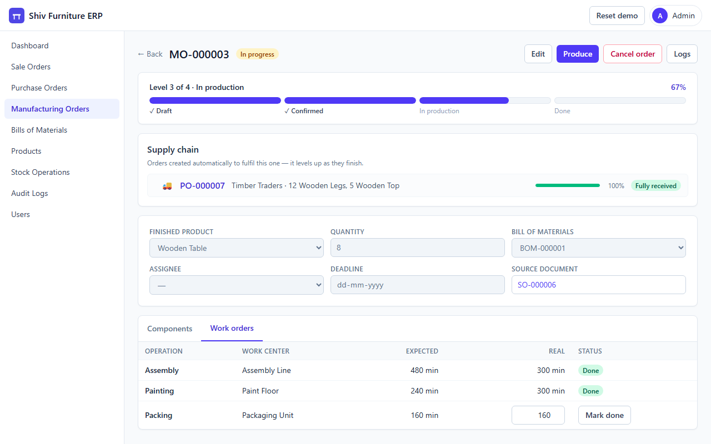
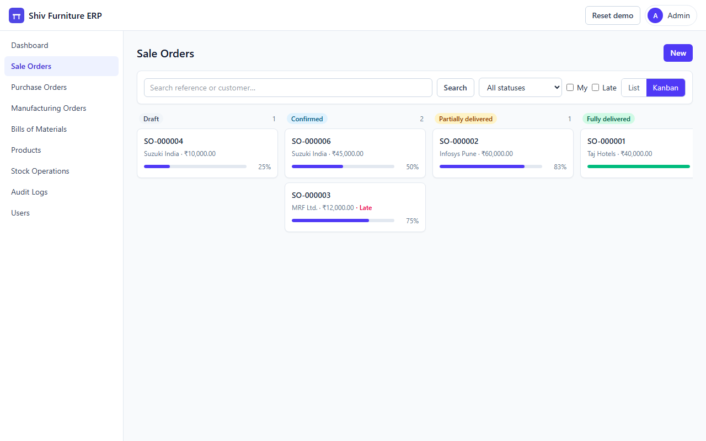
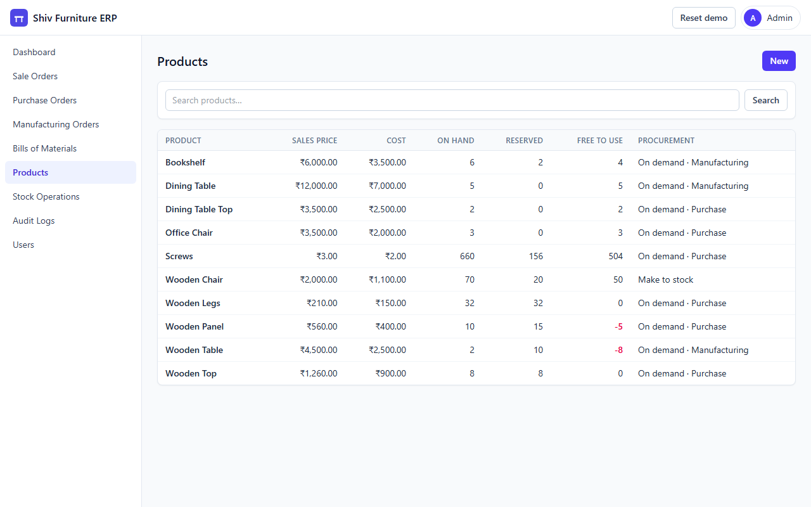
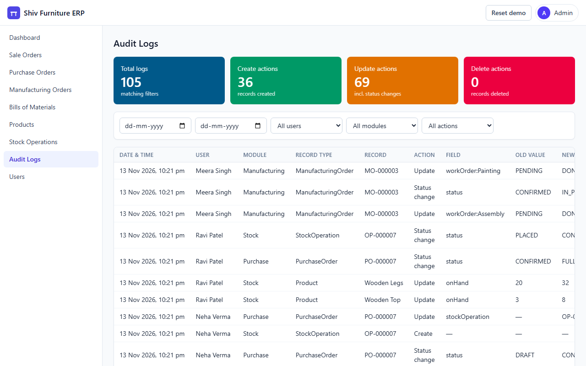
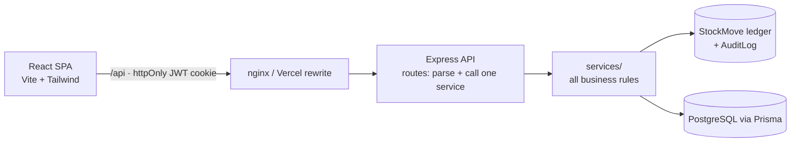

# Shiv Furniture ERP — Mini ERP from demand to delivery

[](https://github.com/InfernoAnant/Mini_ERP/actions/workflows/ci.yml)


A full-stack mini ERP for a furniture manufacturer. It covers products, sales, purchasing, bills of materials, manufacturing with work orders, a stock ledger, make-to-order auto-procurement, a two-step stock-operation workflow, role-based access, a complete audit trail and game-style "level-up" order progress.

Built with **React 19 + TypeScript 7**, **Node.js 24 / Express 5**, **PostgreSQL / Prisma 7**, **Tailwind CSS 4** and **Vite 8**. It has 131 API tests, Playwright end-to-end tests of the full business flow, and CI on every pull request and push to `main`.

> **Live demo:** _link added after deployment_. Everyone shares the demo, so click **Reset demo data** on the login page first.



---

## Quick start

**With Docker** (nothing else to install):

```bash
docker compose up --build
```

Then open **http://localhost:8080** and click any demo account. Postgres, the API and the web app start together, and the demo data loads automatically on first start.

> ⚠️ This stack is a **demo**: anyone can reset the data or log in as a demo account without a password, and the JWT secret is a placeholder. Don't expose it to the internet as-is.

**Without Docker:** see [Development](#development).

## Try it in two minutes

Log in with one click from the login page. No passwords needed.

| Demo account                       | Role                      | What they can do                                      |
| ---------------------------------- | ------------------------- | ----------------------------------------------------- |
| **System Admin**                   | Administrator             | Everything, plus user management and audit logs       |
| **Sales Manager** (Amit Sharma)    | Sales admin               | Create/confirm sales orders, deliver                  |
| **Purchase Manager** (Neha Verma)  | Purchase admin            | Confirm purchase orders, receive goods                |
| **Production Head** (Meera Singh)  | Manufacturing + BoM admin | Bills of materials, manufacturing orders, work orders |
| **Inventory Manager** (Ravi Patel) | Products admin            | Adjusts stock and confirms any stock operation        |
| **Business Owner** (Shiv Kumar)    | Read-only                 | Sees every module, changes nothing                    |

**The demo script** (the Wooden Table has only 2 in stock). It's also the automated e2e test [`e2e/demo-flow.spec.ts`](e2e/demo-flow.spec.ts).

1. **Sales Manager** → Sale Orders → New → Suzuki India, _10 × Wooden Table_ → **Confirm**.
   The order hits **Level 2 of 4**, and a draft **manufacturing order for 8** appears in its _Supply chain_.
2. **Production Head** → open that MO → **Confirm**. Its components are reserved, and the missing ones
   (12 Wooden Legs, 5 Wooden Tops) **auto-create one purchase order** to Timber Traders.
3. **Purchase Manager** → open the PO → **Confirm** → **Receive**. The receipt is only _placed_.
4. **Inventory Manager** → Stock Operations → **Confirm** the receipt. Now stock arrives, and the PO bar fills to 100% 🎉.
5. **Production Head** → MO → Work orders → **Mark done** ×3 → **Produce** → Confirm. The MO completes.
6. **Sales Manager** → the order has levelled up to **Supplied** → **Deliver** 10 → Confirm → _Fully delivered_, 100% 🎉.
7. **System Admin** → Audit Logs, or the **Logs** button on any record. Every status change, quantity and price change is there, with old and new values.

## Screenshots

| Dashboard                                       | Manufacturing work orders                                         |
| ----------------------------------------------- | ----------------------------------------------------------------- |
|  |  |

| Sales kanban with progress                      | Products & live stock                               | Audit log                                       |
| ----------------------------------------------- | --------------------------------------------------- | ----------------------------------------------- |
|  |  |  |

## Features

- **Products** with sales and cost price, and live **on hand / reserved / free-to-use** (free = on hand − reserved, computed, never stored), plus a per-product stock ledger.
- **Sales orders**: Draft → Confirmed → Partially / Fully Delivered (or Cancelled). Lines warn when free-to-use stock is short. Confirmed orders can still be **edited** (never below what is delivered or pending).
- **Purchase orders**: Draft → Confirmed → Partially / Fully Received.
- **Bills of materials**: components plus operations at work centers.
- **Manufacturing orders**: take a snapshot of the BoM, scale it to quantity, reserve components, track **work orders** (expected vs real minutes), and **Produce** (consume components, add finished goods).
- **Make-to-order procurement**: products marked _Procure on demand_ auto-create a draft PO (grouped per vendor) or MO for exactly the shortfall. Shortage = demanded − max(free-to-use, 0), so nothing is ordered twice.
- **Place → confirm stock operations**: deliveries, receipts, production and stock adjustments are _placed_, and stock only moves when a **supervisor or manager confirms** them. Operations can be rejected with a reason, and cancelling an order rejects its pending operations.
- **Level-up progress**: every order has a 4-level bar ("Level 3 of 4 · Supplied · 75%") and a _Supply chain_ tree of the orders it's waiting on. A small confetti burst plays at the end of the bar when your action completes an order.
- **Role-based access**: per user and per module, _Admin / User / None_ (plus read-only), enforced on the server and mirrored in the UI.
- **Audit log** of every create, field change, status change and delete, written in the same database transaction as the change itself.
- **Dashboard** with _All_ / _My_ status chips per module, late orders, operations awaiting confirmation and material shortages. Every chip deep-links into a filtered list.

## Architecture



```
client/src     pages/<module>, components/, api/ (fetch client + DTO types), context/ (auth + permissions)
server/src     routes/, services/ (business rules), middleware/, config/permissions.ts
server/prisma  schema.prisma, migrations, seed.ts
server/test    Vitest + Supertest against a real PostgreSQL test database
e2e/           Playwright: the full demand-to-delivery flow, role checks, README screenshots
```

## Design decisions

- **The stock ledger is the source of truth.** Stock changes only through `StockMove` rows written by one function (`postMoves`). `Product.onHand` is a cache updated in the same transaction, and tests assert that the ledger sum always equals on-hand.
- **Concurrency-safe stock.** Every stock-changing transaction row-locks the affected products (`SELECT … FOR UPDATE`, in id order). A test fires two deliveries of the last 5 units at once: exactly one succeeds, and on-hand never goes negative.
- **Consistent lock order:** source order → stock operation → products, everywhere, so a _cancel_ racing a _confirm_ can't deadlock.
- **Audit in the same transaction** as the change it describes, so the log can't disagree with the data.
- **Two-step stock operations** model real dispatch and receiving sign-off, and keep reservations intact while an operation waits.
- **Exact decimals.** Quantities are `Decimal(12,3)` and money is `Decimal(12,2)`, compared with decimal math (1.25 + 1.25 of 2.5 is exactly _fully delivered_).
- **Progress is computed on the server** (`progress.service.ts`), so React only draws it. Business logic never lives in the UI.
- **Permissions in one place** (`config/permissions.ts`), checked inside services, so the same rules apply to the API, seeding and auto-procurement.

## Development

Requirements: **Node 24 LTS** (`.nvmrc`; `nvm use`) and PostgreSQL 16+ with two empty databases, `minierp_dev` and `minierp_test`. Or just use Docker, as above.

```bash
npm install                    # root tooling: ESLint, Prettier, Husky, Playwright
cd server
cp .env.example .env           # DATABASE_URL → minierp_dev, JWT_SECRET
cp .env.example .env.test      # DATABASE_URL → minierp_test
npm install && npx prisma migrate dev && npx prisma db seed
npm run dev                    # API on http://localhost:5000
```

```bash
cd client && npm install && npm run dev   # http://localhost:5173 (proxies /api to :5000)
```

| Command                     | What it does                                                          |
| --------------------------- | --------------------------------------------------------------------- |
| `npm run lint`              | ESLint (TypeScript + React hooks rules) across server, client and e2e |
| `npm run format` / `:check` | Prettier                                                              |
| `npm run typecheck`         | `tsc` for server and client                                           |
| `npm test`                  | 131 server tests (Vitest, real Postgres)                              |
| `npm run test:e2e`          | Playwright: the full business flow in a real browser                  |

A Husky pre-commit hook runs ESLint and Prettier on staged files. CI (GitHub Actions) runs lint, typecheck, server tests, the client build, Playwright and a Docker Compose smoke test on every pull request and every push to `main`.

> On Windows, Vitest's forked worker occasionally aborts natively (exit `0xC0000409`) — a Node/Windows issue, not the app. `server/npm test` re-runs **only** in that case and says so; real failures are never retried. CI runs on Linux.

## Deployment

- **API:** Render (`render.yaml`, Node 24), running `prisma migrate deploy` on start. Set `AUTO_SEED=true` to load the demo into an empty database.
- **Database:** Neon PostgreSQL.
- **Web:** Vercel (`vercel.json`). `/api/*` is rewritten to the API, so the auth cookie stays first-party (`SameSite=Lax`, `Secure`).

## Out of scope

Accounting, invoicing, payments and taxes · multiple warehouses, lots and serial numbers · email and notifications · mobile app · multi-company and multi-currency.
